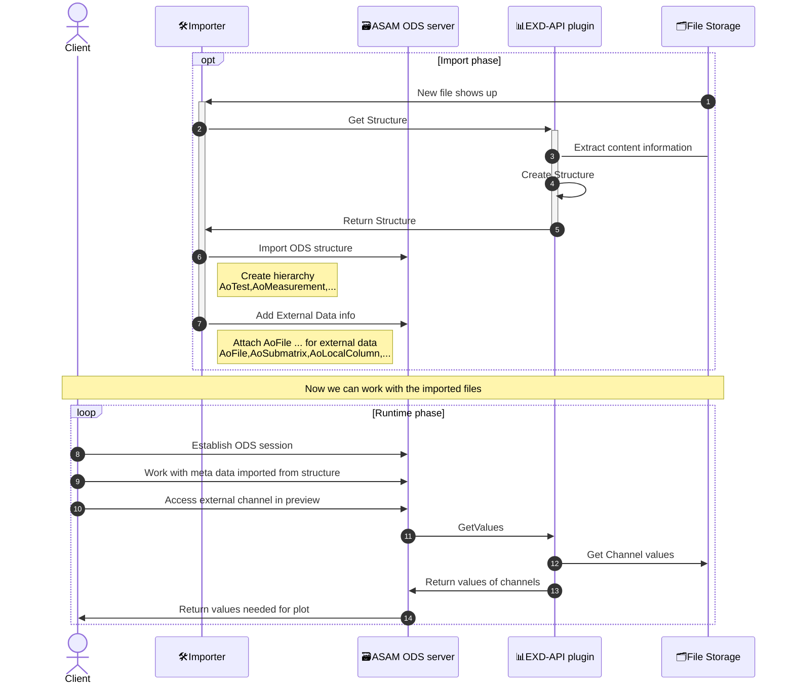

# ASAM ODS EXD-API DuckDB plugin

[](https://github.com/peak-solution/asam_ods_exd_api_duckdb/actions/workflows/docker-build.yml)
[](https://pypi.org/project/asam-ods-exd-api-duckdb/)
[](https://pypi.org/project/asam-ods-exd-api-duckdb/)
[](https://opensource.org/licenses/MIT)

This repository contains a [ASAM ODS EXD-API](https://www.asam.net/standards/detail/ods/) plugin that uses [DuckDB](https://duckdb.org/) to read DuckDB database files.

It is built on the [ods-exd-api-box](https://pypi.org/project/ods-exd-api-box/) helper library which provides the gRPC server infrastructure and proto stubs.

## Content

### Implementation
* [external_data_file.py](external_data_file.py)<br>
  Implements the `ExdFileInterface` from `ods-exd-api-box` to access DuckDB files using [duckdb](https://pypi.org/project/duckdb/).
  Also contains the entry point to run the gRPC service.

### Normalized Mode

The plugin reads DuckDB tables in normalized form by default. Identifier parameters no longer switch between modes.

All tables are interpreted with this schema:

```sql
CREATE TABLE mea (
  channel_id BIGINT,
  index BIGINT,
  value UNION(
    DT_DOUBLE DOUBLE,
    DT_FLOAT FLOAT,
    DT_SHORT SHORT,
    DT_LONG INT,
    DT_LONGLONG LONG,
    DT_STRING VARCHAR
  ),
  flag SHORT
)
```

Channel mapping rules in normalized mode:

1. One channel is created per distinct `channel_id` value.
2. Values are read from `value` and converted by the active UNION member.
3. `index` is used for ordering and row counting (`COUNT(DISTINCT index)`).
4. `flag` is currently parsed as part of the schema but not interpreted functionally.

ValuesAppender `Append` response semantics:

1. `row_count_by_group` map values represent the current `MAX(index)` per touched group.
2. Channels appended within the same group in one request must have equal payload lengths.

### Tests
* [test_exd_api.py](tests/test_exd_api.py)<br>
  Some basic tests on example files in `data` folder.
* [example_access_exd_api_duckdb.ipynb](example_access_exd_api_duckdb.ipynb)<br>
  jupyter notebook the shows communication done by ASAM ODS server or Importer using the EXD-API plugin.

## Development

### Setup

Install [uv](https://docs.astral.sh/uv/) and then install the project with dev dependencies:

```
uv sync --group dev
```

### Run Tests

```
uv run python -m unittest discover tests
```

### Run Plugin Locally

Use an explicit IPv4 bind address on Windows to avoid IPv6 bind issues:

```bash
uv run asam-ods-exd-api-duckdb --bind-address 127.0.0.1 --port 50051
```

Stop the server with `Ctrl+C`. A non-zero exit code after interruption is expected.

### Run Plugin With uvx

Run the latest published package without installing it into the current project environment:

```bash
uvx asam-ods-exd-api-duckdb --bind-address 127.0.0.1 --port 50051
```

### Code Quality

```bash
uv sync --group dev                    # 1. Install all dependencies
uv run ruff format .                   # 2. Format code
uv run ruff check --fix .              # 3. Fix lint violations
uv run mypy external_data_file.py      # 4. Type check
uv run python -m unittest discover tests  # 5. Run tests
```

## Docker

### Docker Image Details

The Docker image for this project is available at:

`ghcr.io/peak-solution/asam-ods-exd-api-duckdb:latest`

This image is automatically built and pushed via a GitHub Actions workflow. To pull and run the image:

```
docker pull ghcr.io/peak-solution/asam-ods-exd-api-duckdb:latest
docker run -v /path/to/local/data:/data -p 50051:50051 ghcr.io/peak-solution/asam-ods-exd-api-duckdb:latest
```

### Using the Docker Container

To build the Docker image locally:
```
docker build -t asam-ods-exd-api-duckdb .
```

To start the Docker container:
```
docker run -v /path/to/local/data:/data -p 50051:50051 asam-ods-exd-api-duckdb
```

have a look at [start options](https://totonga.github.io/ods-exd-api-box/server-options.html) to
figure out how to customize the behavior of the EXD-API plugin.

## Architecture and Usage in ODS Server


