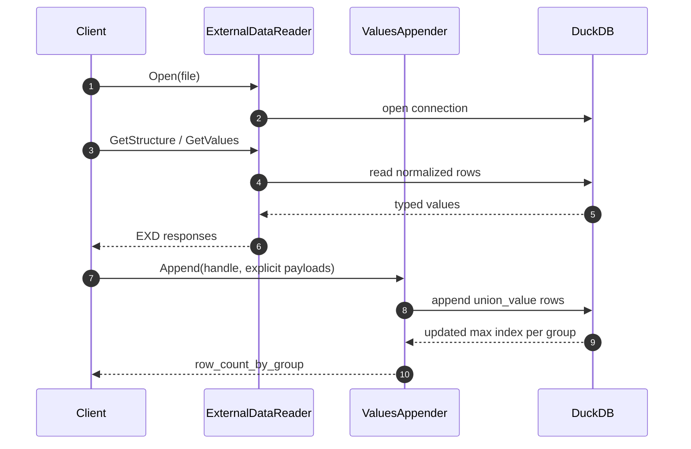

# ASAM ODS EXD-API DuckDB plugin

[](https://github.com/peak-solution/asam_ods_exd_api_duckdb/actions/workflows/docker-build.yml)
[](https://pypi.org/project/asam-ods-exd-api-duckdb/)
[](https://pypi.org/project/asam-ods-exd-api-duckdb/)
[](https://opensource.org/licenses/MIT)

ASAM ODS External Data API plugin for DuckDB.

The project provides a gRPC server implementation based on
[ods-exd-api-box](https://pypi.org/project/ods-exd-api-box/) with:

- ExternalDataReader service (EXD read interface)
- ValuesAppender sidecar service (append/write interface)

## Current State

- Runtime data model is normalized-only.
- Reader and appender share the same DuckDB file handle lifecycle.
- Default executable starts the dual-service server.
- End-to-end tests cover read, append, datatype handling, and Docker runtime.

## Data Model (Normalized Tables)

Each table in the DuckDB file must use this column schema:

```sql
CREATE TABLE sm1 (
  channel_id BIGINT,
  "index" DOUBLE,
  value UNION(
    DT_DOUBLE DOUBLE,
    DT_FLOAT FLOAT,
    DT_SHORT SHORT,
    DT_LONG INT,
    DT_LONGLONG LONG,
    DT_STRING VARCHAR,
    DT_BOOLEAN BOOLEAN,
    DT_BYTE UTINYINT,
    DT_COMPLEX STRUCT(re FLOAT, im FLOAT),
    DT_DCOMPLEX STRUCT(re DOUBLE, im DOUBLE),
    DT_BYTESTR BLOB,
    DT_DATE VARCHAR
  ),
  flag SHORT
);
```

Reader behavior:

1. Each DuckDB table is exposed as one ODS group.
2. Each distinct channel_id in a table is exposed as one ODS channel.
3. Group row count is computed as max(index) + 1.
4. Values are index-aligned; missing samples are returned as datatype-specific placeholders.
5. Channel results are returned sorted by channel_id.

Group id resolution:

1. Preferred table lookup is by name sm<group_id>.
2. Legacy fallback is ordinal table position if sm<group_id> is absent.

## ValuesAppender Service

The sidecar gRPC service supports:

- Init: creates an in-memory DuckDB file for requested group ids and returns its bytes.
- Append: appends explicit payloads to an opened DuckDB file.

Append contract (validated by tests):

1. handle.uuid must reference a file opened via ExternalDataReader.Open.
2. Only explicit payloads are currently supported.
3. Within one channel_group_id, all channels in the same Append request must have equal payload lengths.
4. Appended rows are index-aligned per group.
5. Response field row_count_by_group contains the next index (max(index) + 1) for each touched group.

Supported explicit datatypes:

- DT_DOUBLE
- DT_FLOAT
- DT_SHORT
- DT_LONG
- DT_LONGLONG
- DT_STRING
- DT_BOOLEAN
- DT_BYTE
- DT_BYTESTR
- DT_DATE (stored as ISO-8601 UTC string)
- DT_COMPLEX
- DT_DCOMPLEX

## Repository Layout

- external_data_file.py: EXD file handler implementation for DuckDB.
- values_append_service.py: ValuesAppender gRPC implementation.
- exd_duckdb_server.py: dual gRPC server entry point.
- tests/: unit and integration test suite.
- data/: example and generated test data files.
- proto/ and protobuf_generated/: protobuf definitions and generated stubs.
- example_access_exd_api_duckdb.ipynb: notebook with EXD API communication examples.

## Requirements

- Python 3.14+
- [uv](https://docs.astral.sh/uv/) for local development
- Docker (optional, for container workflows and Docker integration tests)

## Development Setup

```bash
uv sync --group dev
```

## Run Locally

Start the dual-service gRPC server:

```bash
uv run asam-ods-exd-api-duckdb --bind-address 127.0.0.1 --port 50051
```

Run the latest published version without local install:

```bash
uvx asam-ods-exd-api-duckdb --bind-address 127.0.0.1 --port 50051
```

## Test

Run all tests:

```bash
uv run python -m unittest discover tests
```

Optional heavy append performance test:

```bash
RUN_PERFORMANCE_TESTS=1 PERF_APPEND_ROUNDS=100 PERF_APPEND_COLUMNS=10000 \
uv run python -m unittest tests.test_values_append_service.TestValuesAppenderService.test_append_performance_100x_10000_single_value_requests
```

## Code Quality

```bash
uv run ruff format .
uv run ruff check --fix .
uv run mypy external_data_file.py values_append_service.py exd_duckdb_server.py
```

## Docker

Published image:

```text
ghcr.io/peak-solution/asam-ods-exd-api-duckdb:latest
```

Build locally:

```bash
docker build -t asam-ods-exd-api-duckdb .
```

Run locally:

```bash
docker run --rm -it -p 50051:50051 asam-ods-exd-api-duckdb
```

Run published image:

```bash
docker pull ghcr.io/peak-solution/asam-ods-exd-api-duckdb:latest
docker run --rm -it -p 50051:50051 ghcr.io/peak-solution/asam-ods-exd-api-duckdb:latest
```

For additional server flags (TLS, health checks, worker settings), see
[ods-exd-api-box server options](https://totonga.github.io/ods-exd-api-box/server-options.html).

## High-Level Flow


